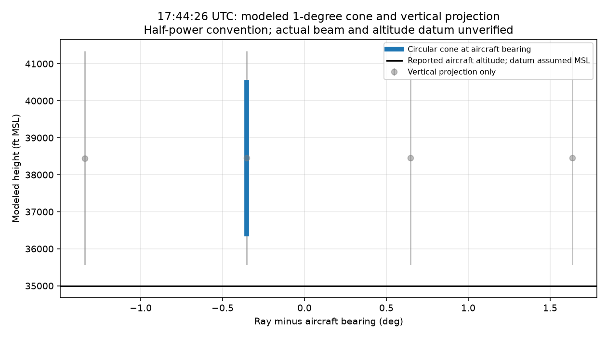

# N722BD: independent radar validation and 3D sampling reconstruction

Analysis date: November 2, 2026. Evidence date: November 1, 2026 UTC.
Independent technical investigation; no official accident finding or causal
conclusion. This report supersedes the repository's preliminary decoder and
beam-screen conclusions. Source observations, calculations and interpretations
are distinguished below.

## Evidence, calculations and interpretation

| Category | What this investigation establishes | What remains unestablished |
|---|---|---|
| Verified source observations and decoding | The preserved FR24 file contains the reported positions, altitudes and timestamps; the preserved radar archives contain the decoded ray metadata and moment codes. Checksums and decoder comparisons are reproducible. | Provider-reported positions have not been authenticated as raw GPS measurements. Source accuracy, acquisition completeness, clock accuracy and sensor calibration are not established by agreement between files or decoders. |
| Calculated geographic relationships | WGS84 distances/bearings, bounded aircraft-state interpolation and nominal beam/gate intersections follow the documented inputs and model. | An intersection is a model-dependent calculation, not an observed aircraft weather encounter. Aircraft altitude datum, refraction and actual beam characteristics remain uncertain. |
| Analytical interpretations and hypotheses | The datasets permit review of reported track/altitude changes and sampled radar conditions. | Weather avoidance, intentional maneuvering, storm exposure and relationships to the Mar-a-Lago perimeter have not been established. Geographic proximity alone cannot demonstrate intent, routing constraints or causation. |
| Unresolved limitations | Custom decoder omissions, sparse observations and finite radar sampling are quantified where possible. | ATC synchronization, applicable airspace boundaries and whether a TFR was active at the relevant time are unverified. |

**Test scope:** Passing scientific tests validates the tested calculation paths
and boundary behavior under stated assumptions. It does not establish that the
assumptions are physically correct, or that the underlying evidence is accurate,
authentic or complete. Agreement between the custom decoder and Py-ART supports
decoding consistency on the compared data; it is not independent validation of
the weather, aircraft state or accident narrative.

The current suite has 25 tests: twenty-one boundary/plot/adversarial tests and four recorded-result
regressions. The latter recompute the reviewed 48,600/29,556 ray counts and
3,929 SW omissions from committed per-ray CSVs, and check that nominal geometric
overlap with masked moments is distinct from a valid moment measurement.
These regression checks detect changes to the recorded findings; they do not
rerun the five raw archives or independently certify the numerical results.

No ATC audio, transcripts or radar-track records have been synchronized to this
timeline. Assessing weather avoidance or intentional maneuvering would require
corroborating operational evidence. A geographic reference calculation is
reported below using a sourced FAA **proposed** circle. It is not a property
perimeter or proof of operative airspace. Historical FAA NOTAM/TFR evidence with
effective UTC intervals, geometry, altitude limits and applicable exceptions
remains missing. This report makes no finding of TFR activity, entry, violation
or causal relevance.

## Evidence integrity and execution

All six pre-existing manifest entries match the received ZIP in both byte size
and SHA-256. The original flight CSV and five radar archives are committed under
their original filenames. All 24 package members have preserved copies mapped
by `supplied_package_manifest.csv`; originals are never overwritten by the new
analysis. The ZIP's SHA-256 is
`4796e260f7ac30527d2760530a275c1e7562a13ce8bb8e069101a3a19fde08a0`.
Its provenance and retention are documented in [data/README.md](../data/README.md).
Hash agreement verifies receipt integrity, not authenticity or completeness of
the provider's original acquisition.
The original source files, both manifests and the byte-preserving Git attributes
are included in the pull request so they enter `main` with the reviewed change.
Reviewing or updating this report does not authorize a merge.

The initial dependency installation failed because the disk was nearly full.
A low-level Py-ART fallback ran under Python 3.14. After storage became available,
the full Python 3.11.15 environment was installed and the authoritative analysis
rerun. ARM Py-ART 2.3.0, NumPy, Pandas, SciPy, Matplotlib, netCDF4 and pyproj are
installed, with exact versions in `requirements.lock`. The earlier fallback's
spherical-distance candidate results are superseded by the delivered WGS84 run.

`validate_n722bd_pyart.py --all-rays` completed against **all five volumes** using
`pyart.io.read_nexrad_archive(linear_interp=False)`. The original script's fixed
bearing and 17:35–17:57 window were disabled; that window would omit later rays
from the final volume. The enhanced script samples the nearest common-grid gate
to 117.467 km on every ray. Native-gate validation and moving-aircraft matching
are separate products, with no common-grid remapping.

## Independently verified decoder results

| Volume filename time (UTC) | Py-ART rays | Custom rays | Omitted by custom | Sweeps |
|---|---:|---:|---:|---:|
| 17:35:07 | 9,720 | 6,245 | 3,475 | 19 |
| 17:40:32 | 9,720 | 5,674 | 4,046 | 19 |
| 17:45:48 | 9,720 | 5,789 | 3,931 | 19 |
| 17:51:04 | 9,720 | 5,933 | 3,787 | 19 |
| 17:56:21 | 9,720 | 5,915 | 3,805 | 19 |
| **Total** | **48,600** | **29,556** | **19,044 (39.19%)** | **95** |

Every custom ray has an exact Py-ART match on decoded UTC collection time,
azimuth, elevation and elevation number. There are no custom-only rays.
Native range origin, gate spacing, raw codes and missing/range-folded masks agree
where both parsers return the moment. Scale/offset conversion produces zero
numeric differences across 35,578,936 reflectivity gates, 11,112,860 velocity
gates and 6,429,492 spectrum-width gates. These comparisons do **not** validate
the omitted rays or missing moments through the custom implementation.

On shared rays, the custom parser omits spectrum width **3,929 times** when
Py-ART returns it. The supplied message slice starts after 12 legacy CTM bytes
plus the 16-byte message header but ends without the corresponding 12-byte
offset correction. An inspected ray at 17:35:25.079 has a 3,812-byte custom body,
while its SW block ends at byte 3,824. The custom bounds check drops that moment.
The custom record traversal also silently breaks on invalid sizes/decompression
instead of reporting incomplete coverage. The exact contribution of each
traversal failure to the 19,044 omitted rays has not been isolated; the original
decoder is preserved rather than silently repaired.

The full Py-ART API and its native reader agree on all 48,600 ray timestamps and
azimuth/elevation metadata, site latitude/longitude/height, radial indices, and
all three sampled moments' masks.
Maximum numeric differences are zero at the checked gate, with 13,404 valid REF,
8,211 VEL and 8,207 SW ray samples. This is an **internal Py-ART API consistency
check**, not a third independent decoder or an all-gate API comparison. The
custom-versus-Py-ART native comparison is an implementation check. A separate
review byte walker (`scripts/review/independent_decode.py`) also compares all
121,557,600 native REF/VEL/SW codes and their descriptors against installed
Py-ART, with no differences on these five files. It independently recovers the
custom ray/SW omissions. It is restricted to these compressed Message-31 files:
ancillary Message 32 is skipped and a final 12-byte legacy framing advance is
accepted only after referenced moment data fit. This follows Py-ART's framing
convention and is not a general format-conformance oracle or independent
atmospheric observation. The validation checker now rejects nonfinite required
metadata and missing comparison coverage. Geometry failures are counted even
when unequal array lengths prevent element comparisons.

The encoded site coordinates are 25.611083984375 N, −80.41266632080078 E.
Py-ART decodes radar site plus feedhorn height as **33 m MSL**, replacing the
preliminary code's 4 m assumption. This is header evidence, not a new site
survey or independent vertical-datum verification. Actual ray times extend
through **18:01:20.523 UTC**, beyond the final archive's nominal start time.

## Flight observations and reconstruction method

The supplied CSV contains **78,107 rows** from 14:17:03.168653 to
17:49:32.411285 UTC, with 16,107 position-bearing rows. Columns are asynchronous.
The delivered position-time state timeline has 16,107 rows, of which 15,059 have
altitude supported by exact observations or bounded interpolation. Reported
vertical rate is retained separately from an altitude-difference rate; agreement
between two derivative quantities is not independent sensor corroboration.

Position and altitude are interpolated separately at each ray's actual UTC
timestamp, only with observations within ten seconds on **each** side. Exact
observations at endpoints are accepted. There is no extrapolation or forward
filling. The state timeline also brackets ground speed, circular track and
reported vertical rate separately, recording support times and missingness.
Latitude/longitude use short-interval linear interpolation, not a fitted flight
dynamics model. Position and clock error distributions are unavailable.
The full track has 14 position gaps longer than 20 seconds, with a maximum gap
of about 434 seconds. Exported path lines are split across those gaps rather
than drawn as continuous observed flight segments.
Both GeoJSON and per-volume PNG track lines use that same segmentation rule;
isolated observed positions remain visible as individual points. The PNG
regression checks actual plotted segments at the 20/21-second gap boundary.

The prior analyses identify altitude as feet, ground speed as knots and vertical
rate as ft/min; these units are carried forward explicitly. The CSV itself does
not document the altitude datum, pressure correction or source encoding. Treating
reported altitude as MSL is an **assumption for geometric screening**, not a
verified measurement datum. Datum error could exceed a near-beam separation.

Radar-to-aircraft surface distance and bearing use WGS84 geodesics. Native gates
are selected using the **aircraft point's modeled slant range**, calculated from
surface distance and assumed-MSL altitude in the same effective-radius model.
The beam-axis slant range at the aircraft's surface distance is a different
point; its samples are retained separately in `axis_REF_*`, `axis_VEL_*` and
`axis_SW_*`. The earlier reconstruction sampled that beam-axis point. The
original custom screen used ground distance as slant range. The vertical model uses a
6,371-km Earth radius with nominal effective-radius factor k=4/3. Beam center
height is `sqrt(r² + (kR)² + 2*r*kR*sin(elevation)) - kR + site_height`.
The inverse surface-distance relation uses the same effective-radius geometry.
For surface distance d, radius a=kR and aircraft height h relative to the radar,
the radar-local point is x=(a+h) sin(d/a), z=(a+h) cos(d/a)-a. Slant range is
hypot(x,z); apparent elevation is atan2(z,x). Joint angular overlap uses the
three-dimensional angle between that direction and the ray axis, compared with
half the assumed full beamwidth. A native moment also needs a containing range
cell; this is recorded separately from whether its code is valid or masked.

The circular cone is an explicit antenna approximation, not a measured pattern.
Half-power and half-gate-spacing conventions are not hard physical sensitivity
limits. Vertical-projection heights are evaluated at the **same ground distance**
for center and edges. Separate horizontal/vertical projection flags are
diagnostics, not a substitute for the circular-cone overlap flag. Cone heights
at the aircraft's actual bearing are also provided. WGS84 distances were checked
with a separate Vincenty implementation: maximum difference 0.0000046 m on the
290 candidates. This verifies calculations on the inputs, not position accuracy.

All nearby rays and all elevation sweeps are evaluated; retained candidates are
within ±2° of the contemporaneous aircraft bearing. No volumetric interpolation
fills unsampled elevations or times. There are **290** retained candidates:
107, 103 and 80 in the first three volumes, and none in the later two because
they lack contemporaneous bracketing aircraft evidence. A ray is a candidate,
not necessarily a usable weather measurement at aircraft altitude.

## 17:44:26 UTC geometry

At **17:44:26.796 UTC**, the reconstructed aircraft state is approximately
26.480315 N, −80.654989 E, with reported altitude 35,000 ft. The supporting
observations bracket the time by approximately 0.451 and 0.071 seconds.
Ray 7,728 in the 17:40 volume is at elevation 6.372070° and azimuth 345.563965°,
about −0.354° from the WGS84 aircraft bearing.

Calculated ground range is 99.308 km. The modeled aircraft-point slant range is
**99,936.622 m**, selecting the **99,875-m** native gate (250-m spacing). Its
decoded values are **13.5 dBZ reflectivity, −6.0 m/s radial velocity and 1.5 m/s
spectrum width**. These are radar samples at that range, not measurements of the
aircraft or proof of co-location. The beam-axis point at that ground distance has
slant range **100,060.070 m** and selects the adjacent **100,125-m** gate, with
**12.5 dBZ, −6.0 m/s and 0.5 m/s**. Those earlier values remain valid decodings of
that different gate; they must not be labeled aircraft-point samples. Preliminary
ground-as-slant and spherical-fallback values remain superseded.

Under nominal assumptions the beam center is **11,719 m MSL (about 38,449 ft)**.
The lower 1° **vertical projection at the same ground distance** is **10,840.489 m
MSL**, about **172.489 m above** the assumed-MSL aircraft altitude. The former
184.332-m gap used a different, fixed-slant edge point and is withdrawn as a
same-ground separation. At the aircraft's bearing, the circular cone's lower
edge is **11,095.278 m MSL**, a **427.278-m** gap. The axis-to-aircraft angle is
**0.694240°**, exceeding the nominal 0.5° half-width. These are distinct modeled
quantities, not measured clearance from hazardous weather. Neighboring rays at
17:44:26.759, .833 and .868 are retained in the dataset, with their individual
angular offsets, moments and timing. They do not provide simultaneous
measurements at the aircraft's reported height.

Sensitivity scenarios vary k between 1, 4/3 and 1.5, full beamwidth between
0.8°, 1°, 1.2° and 1.5°, and extra altitude tolerance between 0, 500 and 1,000 ft.
At k=4/3 and 1°, neither 500-ft nor 1,000-ft altitude tolerance alone admits
circular-cone overlap. The previous 1,000-ft statement used independent angular
projections and is withdrawn. A 1.5° full-width cone admits angular overlap
without extra altitude tolerance; 1.2° plus 1,000-ft tolerance also does. These are
exploratory scenarios, **not measured instrument errors or confidence bounds**.
Native gate-edge heights and ±1/±2-second relative clock scenarios are supplied.
Each clock scenario re-evaluates **all 48,600 rays before selection**, including
states unsupported at nominal time. `clock_ray_coverage.csv` records all 243,000
evaluations; `clock_sensitivity.csv` gives the newly selected neighboring rays.
Positive shift means querying the aircraft series later than the radar timestamp;
it does not identify which physical clock is wrong. Subsecond CSV precision does
not establish clock accuracy.

## Final observations and coverage limits

| Quantity | Last source timestamp (UTC) | Reported value |
|---|---|---|
| Altitude | 17:49:24.591710 | 8,750 ft |
| Position | 17:49:31.540320 | 26.632278 N, −80.111424 E |
| Ground speed | 17:49:32.165558 | 238 kt |
| Track | 17:49:32.165558 | 289.9° |
| Vertical rate | 17:49:32.165558 | −32,640 ft/min |
| Any CSV observation | 17:49:32.411285 | End of supplied record |

These are different timestamps, not a synchronized final state vector. The
repeated 8,750-ft value and extreme vertical rate remain uncorroborated source
reports. They do not establish impact time, actual descent rate or causation.
The last altitude precedes the final position by approximately 6.95 seconds.

The source contains a decreasing sequence, rather than just one anomalous
vertical-rate value: **118 altitude observations** from 35,000 ft at
17:48:24.780576 to 8,750 ft at 17:49:22.955011, with 117 negative steps and no
positive or unchanged steps. The endpoint difference is 26,250 ft over 58.174435 s,
equivalent to a **provider-series mean change of −27,073.748 ft/min**. It is not
an independently verified aircraft descent rate. The largest observation gap
in this interval is 0.596410 s. Four endpoint 8,750-ft values span 1.636699 s while
three reported vertical-rate samples are −32,640 ft/min. The plateau and rate
cannot jointly be treated as an exact synchronized altitude history. This
discrepancy requires source/transponder evidence; it does not establish a
level-off, terminal speed, impact or failure mechanism. The supporting rows are
in `results/review/reported_descent_observations.csv`.

An additional **encoding hypothesis** warrants checking: standard ADS-B airborne
velocity (TC19) uses a 9-bit vertical-rate magnitude with 64 ft/min steps and a
one-count offset. Its largest decoded magnitude is (511−1)×64 = **32,640 ft/min**,
exactly the reported extreme. This numerical match is not proof of clipping or
proof that the CSV value came from that message type. The original payloads,
vertical-rate source bit (barometric versus GNSS), and provider processing are
needed to determine its meaning. It should not be treated as a precise terminal
descent rate. [Junzi Sun, airborne-velocity decoding](https://mode-s.org/1090mhz/content/ads-b/5-airborne-velocity.html).

The last jointly position-and-altitude-supported neighboring ray is at
**17:49:16.422 UTC**. The ray near **17:49:29.286 UTC** can be screened against
the fixed final-position bearing, but it lacks bracketing altitude support and
is not promoted to a complete moving-aircraft 3D match. The
`fixed_final_position_samples.csv` product labels its noncontemporaneous
reference explicitly. Later volumes cannot establish conditions at an earlier
aircraft state merely by spatial proximity.

One candidate at **17:39:11.040 UTC** satisfies the nominal circular-cone and
native range-cell screen. Its REF/VEL/SW raw codes are all zero, masked as
below-threshold/missing; it is **not a validated weather detection**. Thus the
preliminary categorical statement of zero geometric intersections is not
reproduced, but the new geometric overlap supplies no positive weather-encounter
measurement. Beam edges are half-power conventions, not hard boundaries of
radar sensitivity; non-overlap also cannot establish absence of weather.

## Conclusions tested against alternative assumptions

The review evaluates 55 explicit cases over all rays: nominal, clocks ±1/2/5/10 s,
k=1 and 1.5, widths 0.8/1.2/1.5°, signed altitude changes ±500/1,000 ft, position
displacements 100/500/1,000 m in eight directions, tighter interpolation brackets,
removal of repeated 8,750-ft values, position thinning, and eight combined
clock/altitude/refraction cases. These are diagnostic scenarios, not sampled
error distributions, exhaustive combinations or measured confidence intervals.

- **Supported computational conclusion:** the custom decoder loses substantial
  ray coverage and SW moments. The counts reproduce from preserved bytes using
  the full pipeline and the separate review reader.
- **Supported conditional sampling conclusion:** the nominal model yields one
  geometric overlap, with masked moments; no nominal co-located valid radar
  return is established. All tested clock-only offsets through ±10 s retain that
  result. Some position/combined scenarios remove the masked overlap.
- **The absence of a nominal valid overlap is not robust to all assumptions.**
  A 1.5° beam produces two circular-cone overlaps, one with valid reflectivity
  at 17:44:26.796. A combined −2-s aircraft-query shift, +1,000-ft altitude change
  and k=1.5 also produces a valid-return overlap at that ray. Thus radar/flight
  co-location is possible under specified models; actual storm exposure, weather
  severity and accident causation remain unestablished. Neither 1,000 ft alone
  nor a modeled overlap justifies a hazardous-weather finding.
- **Supported source-series conclusion:** a densely reported altitude decrease
  exists before the record ends. Its physical accuracy, terminal rate and final
  state remain unverified. The final radar/aircraft match remains incomplete.

See `results/review/all_ray_sensitivity.csv`, `target_sensitivity.csv` and
`sensitivity_overlap_examples.csv` for case definitions, counts, and per-ray
values. These checks use separate geometry/interpolation code, but were authored
by the same assistant; they are not an independent human or organizational
endorsement. Agreement of implementations or models is not proof of truth.

## Mar-a-Lago reference geometry

No authenticated property-perimeter dataset or historical operative TFR was
provided. For a bounded geographic check only, FAA NPRM 2026-17957 specifies a
proposed 1-NM circle centered at 26°40′37″N, 80°02′16″W. The document is explicitly
a proposal, not evidence of an active restriction on November 1.
[FAA proposed rule, PDF page 3](https://public-inspection.federalregister.gov/2026-17957.pdf).

The closest supplied position is **6,228.350 m (3.363040 NM)** from that reference
center at **17:49:06.289157 UTC**. Minimizing over geodesic segments joining
observations no more than 20 seconds apart does not yield a closer point. Those
segments are interpolated geometry, not continuous observed tracks. All supplied
positions are outside this proposed 1-NM reference circle; this is not a finding
about an actual property boundary, unobserved intervals, TFR entry or compliance.
Distance alone supports no conclusion about intent or avoidance. Computation and
source reference are preserved in `results/review/perimeter_audit.json`.

## Interpretation and missing evidence

Reflectivity is a radar return measurement, not a direct measure of turbulence.
Doppler radial velocity is scatterer motion projected on the radar line of sight,
not vertical air motion or an aircraft downdraft. Spectrum width measures radial
velocity dispersion within the sample volume and can reflect shear, sampling,
noise and other contributions; it is not calibrated turbulence intensity or EDR.
No dealiasing, hydrometeor classification or aircraft-target identification is
claimed. Masked codes, absent moments and out-of-range samples remain distinct.

No source aircraft altitude datum/pressure correction, verified radar clock or
aircraft clock error, local refractivity profile, independently authenticated
NOAA download, radar calibration/maintenance evidence, flight recorder data,
or independently verified accident timeline was provided. No probabilistic
encounter estimate or causal reconstruction is justified. Wider angular searches,
further radar stations, weather observations and official evidence would be
needed to assess unsampled conditions. The ±2° screen is explicitly finite.

## Deliverables and references

Authoritative generated files are under `results/independent/`: full per-ray
`radar_comparison.csv`, `pyart_api_comparison.csv`, `volume_summary.csv`,
`sweep_coverage.csv`, `aircraft_radar_matches.csv`, `flight_state_timeline.csv`,
`beam_uncertainty.csv`, `clock_sensitivity.csv`, WGS84 GeoJSON overlays and PNG
figures. The overlay polygons are convex projected envelopes of sampled circular-cone
reflectivity range cells, for display rather than intersection tests; their
properties carry sample UTC, moment flags and modeled MSL heights. GeoJSON
coordinates are longitude/latitude with no false ellipsoid-height coordinate.
The figures combine samples from different times and elevations, not a
simultaneous weather volume. Historical supplied products remain separate.

Reproduction commands are in [scripts/README.md](../scripts/README.md).
Execution metadata and checksum audits accompany the generated datasets.

- [ARM Py-ART Archive II reader documentation](https://arm-doe.github.io/pyart/API/generated/pyart.io.read_nexrad_archive.html)
- [Py-ART software citation, Helmus and Collis (2016)](https://doi.org/10.5334/jors.119)
- [NOAA ROC Archive II format ICD](https://www.roc.noaa.gov/public-documents/icds/2620010f.pdf)
- [NOAA NSSL Doppler interpretation guide](https://www.nssl.noaa.gov/publications/dopplerguide/chapter1.php)
- [NWS half-power beam and range-folding explanation](https://www.weather.gov/lmk/radar_sample)

### Supplementary acquisition after this reconstruction

The [2 November public acquisition](public_data_acquisition.md) independently
retrieved the five original KAMX volumes with identical SHA-256 hashes, additional
KAMX/KMLB scans, an ADSB.lol N722BD trace with separate barometric/geometric fields,
weather/satellite/sounding data, and three FAA NOTAM records. These are preserved
and audited separately. The calculations above have **not** been rerun with this
new evidence. In particular, the new trace's altitude discrepancy and the distinct
VIP/security NOTAM intervals require review before revising the flight-state or
airspace discussion. The previous proposed-circle calculation remains a geographic
reference calculation, not a violation determination.

The native reader's license and source hash are preserved under
`scripts/vendor/`. Header timestamps and moment encodings are independently
decoded; atmospheric truth and crash causation have not been established.
